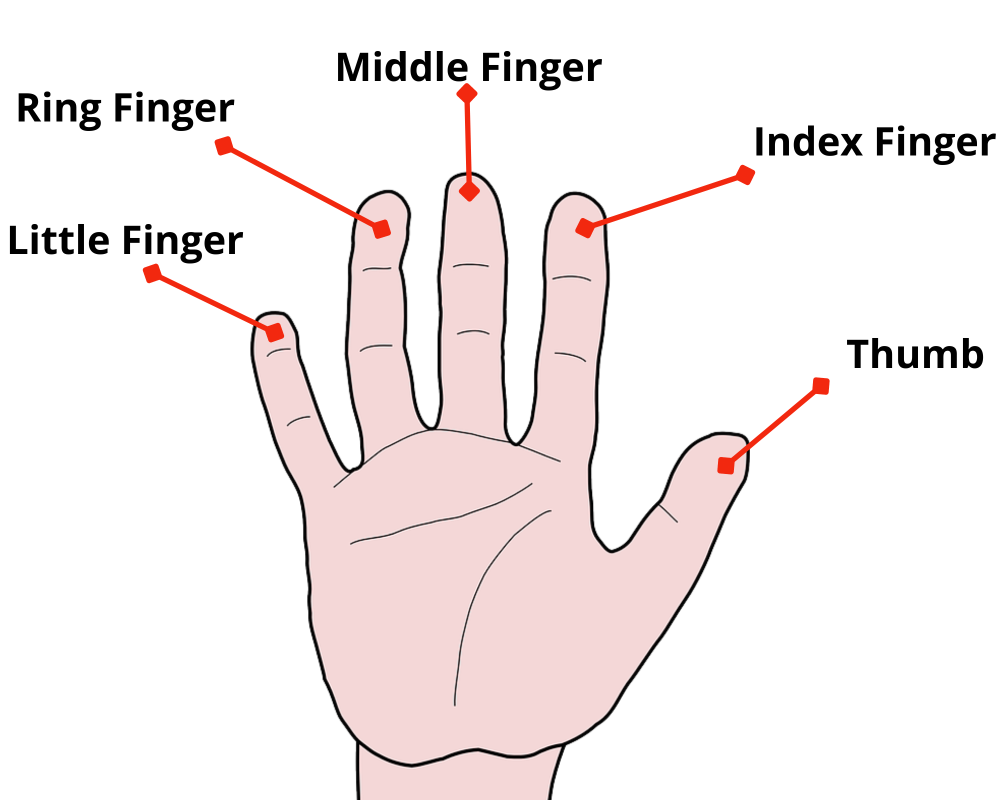

# Gesture Mouse ✋🖱️

Control your computer's mouse with **hand gestures** through a webcam, using **MediaPipe Hand Landmarker**, **OpenCV** and **PyAutoGUI**.

## What I built
This project started from an open-source gesture-mouse app (see [Credits](#credits)) that used MediaPipe's old `mp.solutions.hands` API, which newer MediaPipe releases no longer support. I:
- **Migrated detection to the MediaPipe Tasks API** (`HandLandmarker` in VIDEO mode) with the bundled `hand_landmarker.task` model
- **Wrote a `LandmarkWrapper` adapter** so the existing gesture controller works unchanged with the new landmark format
- **Re-implemented the landmark drawing** (21 points and hand connections) for the live preview
- Added clear exits when no webcam is available, and trimmed the dependencies to the three that are needed

## Gestures
| Gesture | Action |
|---|---|
| Open hand, move it | Move the cursor (tracks the base of the middle finger) |
| All four fingers up, thumb folded down | Freeze the cursor |
| Fist (all fingers down) | Hold the left button to drag; open the hand to drop |
| Index fingertip bent down to the thumb, other fingers up | Left-click |
| Middle fingertip bent down to the thumb, other fingers up | Right-click |
| Ring fingertip bent down to the thumb, other fingers up | Double-click |
| Only the little finger up | Scroll up |
| Only the index finger up | Scroll down |
| Index + middle up and apart | Zoom in (Ctrl + scroll) |
| Index + middle up and touching | Zoom out |



## How it works
```
Webcam frame ─► OpenCV (flip, BGR→RGB) ─► MediaPipe HandLandmarker ─► 21 landmarks
                                                                          │
              PyAutoGUI (move / click / scroll / zoom / drag) ◄─ Controller: which fingers are up?
```

## Run it
```bash
git clone https://github.com/DhanushBattu/handtrack.git
cd handtrack
pip install -r requirements.txt
python app.py        # press Esc to quit
```

## Files
| File | Role |
|---|---|
| `app.py` | Webcam capture, MediaPipe hand detection, landmark drawing |
| `controller.py` | Maps finger positions to mouse actions |
| `hand_landmarker.task` | Pre-trained MediaPipe hand model |

## Limitations
- One hand at a time
- Accuracy drops in low light

## Credits
Based on [Hand-Gesture-Recognition-for-Cursor-Controlling](https://github.com/ahmed-0egy/Hand-Gesture-Recognition-for-Cursor-Controlling) by ahmed-0egy (Apache 2.0). The gesture logic in `controller.py` comes from that project. The changes listed above are mine.

## License
Apache License 2.0, see [LICENSE](LICENSE).
